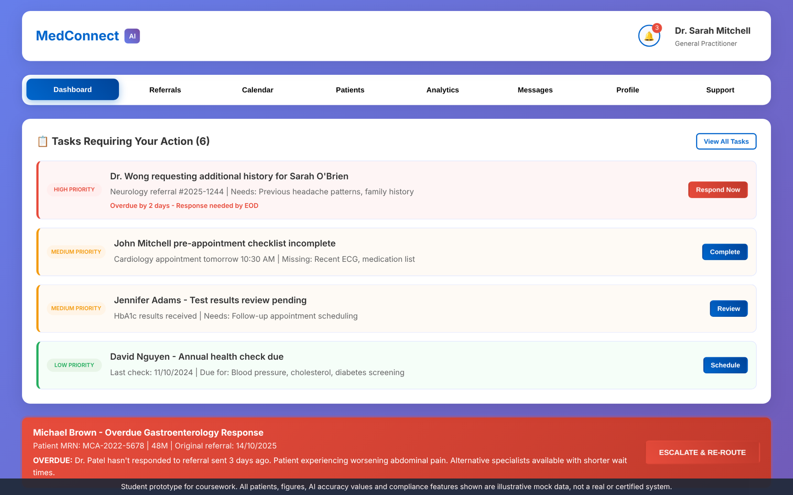
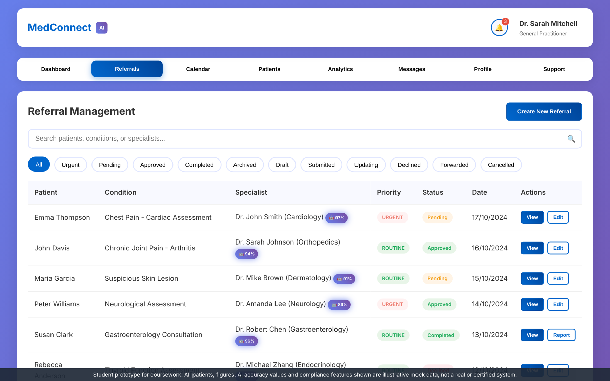
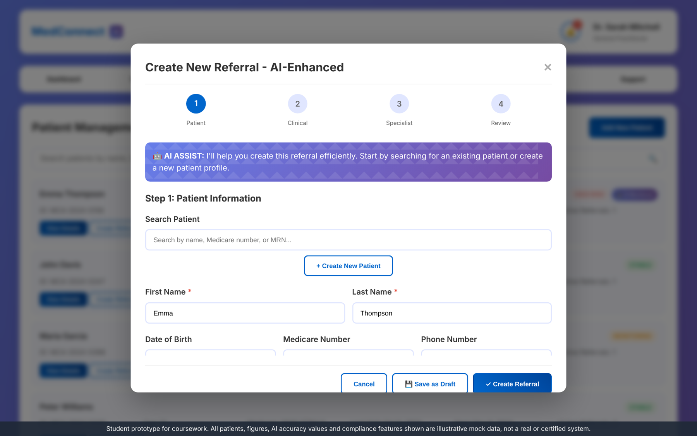
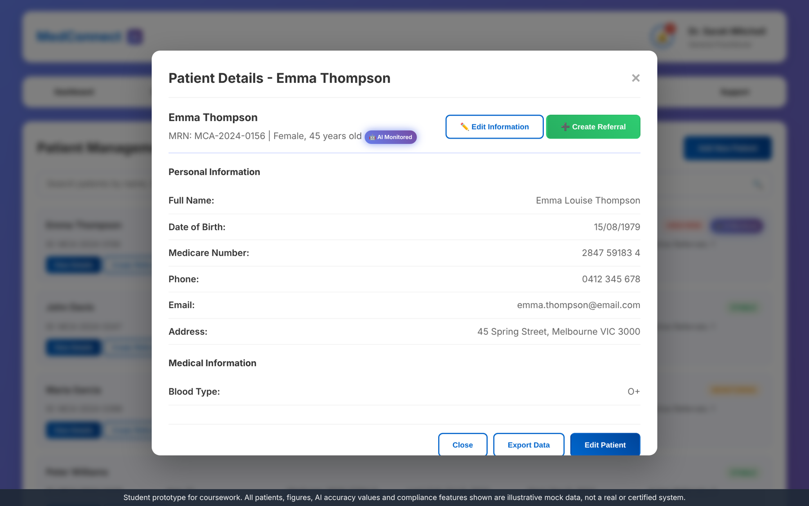

# MedConnect AI: Healthcare Referral Prototype

A clickable prototype of a GP portal for managing patient referrals to specialists in the Australian healthcare system, built for an Information Systems and Business Analysis course. It walks through the full referral lifecycle, from a GP creating a referral to the specialist's response, across dashboard, referral, patient, calendar, analytics and messaging screens.

**[Open the prototype (live)](https://minhphucleluke.github.io/Analytics-Portfolio/medconnect-ai-referral-prototype/medconnectai.html)** · [Prototype file](./medconnectai.html)

> **Prototype only.** There is no backend, no real AI model and no real patient data. Every patient, KPI, accuracy figure and compliance feature shown is illustrative mock content written to demonstrate the design. On the live page, any email and password signs you in.

## The problem it addresses

GP referrals often stall: specialists ask for missing history, responses go overdue, and patients wait without anyone noticing. The prototype puts the GP's open referral work in one place, sorted by urgency, and makes overdue cases visible so they can be escalated or sent to another specialist.

## What the prototype shows

**Dashboard.** Tasks that need the GP's action, colour-coded by priority (for example a specialist asking for more patient history, or test results waiting for review), plus an alert for an overdue specialist response with an escalate-and-reroute action.

**Referral management.** Every referral with its condition, specialist, priority and status, filterable across the full lifecycle: pending, approved, submitted, forwarded, declined, completed, cancelled and archived.

**New referral wizard.** A four-step flow (patient, clinical details, specialist, review) with simulated AI help that suggests a matching specialist and a confidence score.

**Patient records.** Patient profiles with personal and medical information, referral history, and shortcuts to edit the record or start a referral.

**Also included:** an appointment calendar, GP-to-specialist messaging, a practice analytics page, and profile, notification and integration settings.

## Australian healthcare context in the design

The design accounts for the Privacy Act 1988, AHPRA practitioner registration, PRODA, My Health Record and MedicalDirector integration. These appear as design requirements and settings screens only: the prototype is not certified, accredited or connected to any of these systems.

## Tools

`HTML` · `CSS` · `JavaScript` (fully client-side, no backend)
