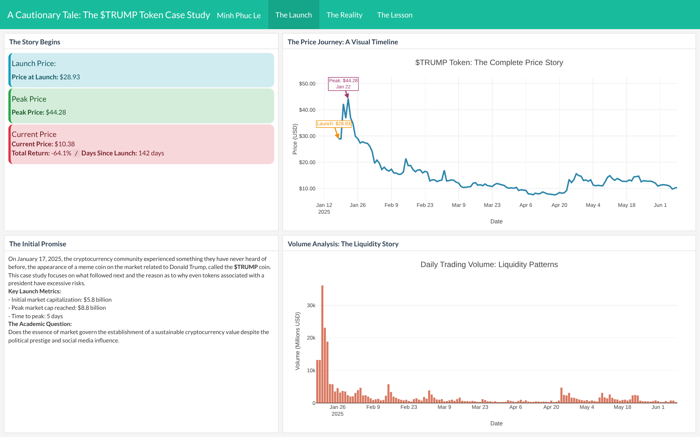
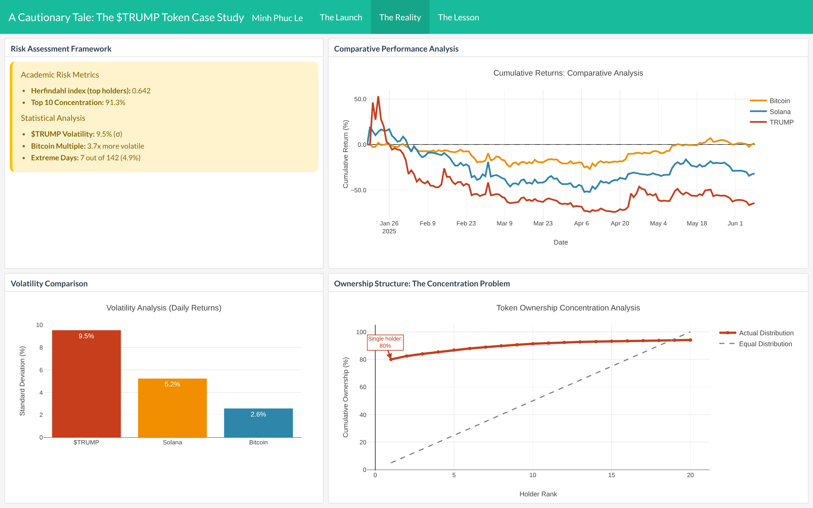
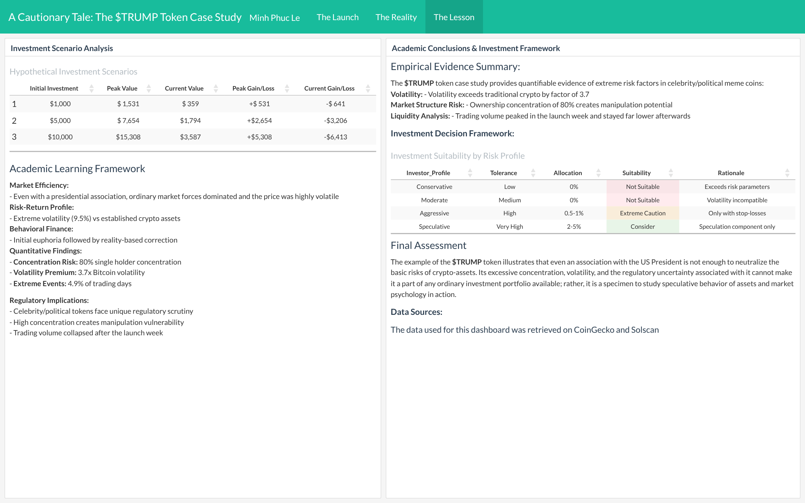

# A Cautionary Tale: The $TRUMP Token Case Study

An interactive data story, built as an R flexdashboard, on why even a meme coin tied to the US President carries extreme investment risk. It follows the $TRUMP token from its launch on 17 January 2025 to 8 June 2025 (142 days) and compares it with Bitcoin and Solana over the same period.

**[Open the interactive dashboard (live)](https://minhphucleluke.github.io/Analytics-Portfolio/storytelling-with-open-data/trump-token-dashboard.html)** · [R Markdown source](./trump-token-case-study.Rmd) · [Published version on RPubs](https://rpubs.com/minhphucleluke/1323425)

## The question

Can political prestige and social media attention create lasting value for a cryptocurrency, or do ordinary market forces win?

## Key findings

- **Boom, then bust.** $TRUMP opened at $28.93, peaked at $44.28 five days later (market cap $8.8 billion), then fell to $10.38 by 8 June 2025: a 64% loss from launch. $1,000 invested at launch would have been worth $359.
- **Far more volatile than established crypto.** The standard deviation of its daily returns was 9.5%, about 3.7 times Bitcoin's (2.6%) and almost twice Solana's (5.2%). It moved more than 20% in a single day on 7 of 142 days.
- **Ownership is extremely concentrated.** The largest holder controls 80% of the supply and the top 10 holders control 91%, giving a Herfindahl concentration index of 0.64.
- **It underperformed the market.** Over the same period Bitcoin ended roughly flat (+1.5%) and Solana fell 32%, while $TRUMP fell 64%.
- **The lesson:** high concentration, volatility and regulatory uncertainty make tokens like this unsuitable for an ordinary portfolio. They are better studied as an example of speculative behaviour.

## How the story is told

The dashboard has three pages, each one step of the narrative:

1. **The Launch:** launch, peak and current price, a timeline of the price with the key moments marked, and trading volume showing how quickly interest faded.
2. **The Reality:** risk metrics, a volatility comparison with Bitcoin and Solana, cumulative returns for all three, and an ownership concentration curve against an equal distribution.
3. **The Lesson:** what different investment scenarios would have returned, and a framework for judging whether an asset like this suits an investor.

## Data

- **Prices, market cap and volume:** daily history for $TRUMP, Bitcoin and Solana exported from [CoinGecko](https://www.coingecko.com/)
- **Token holders:** top $TRUMP holders from [Solscan](https://solscan.io/)

The raw exports are not included in this repo. To rerun the dashboard, download the daily price history for each coin from CoinGecko and the top holders list from Solscan, save them next to the `.Rmd` with the file names it reads, and knit.

## Tools

`R` · `flexdashboard` · `plotly` · `DT` · `dplyr` · `R Markdown`
