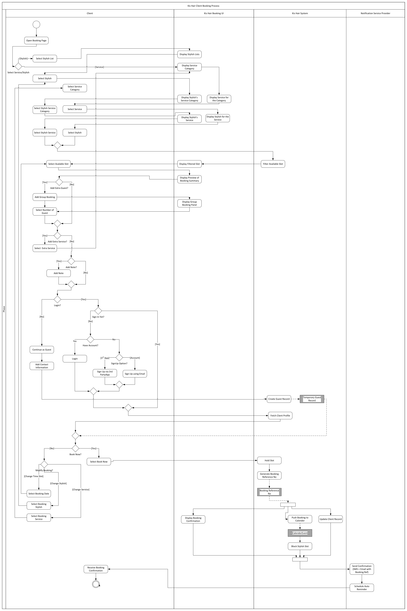
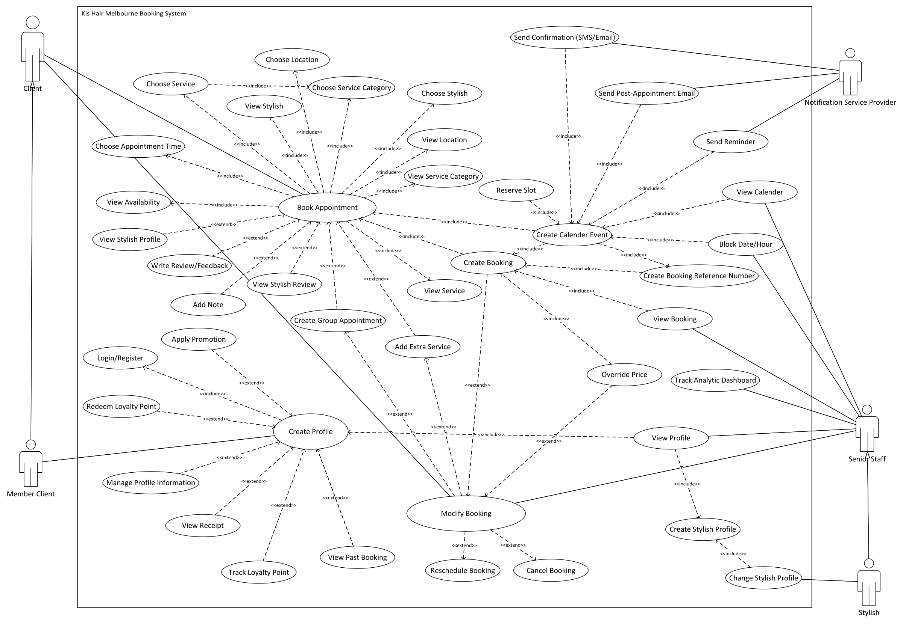
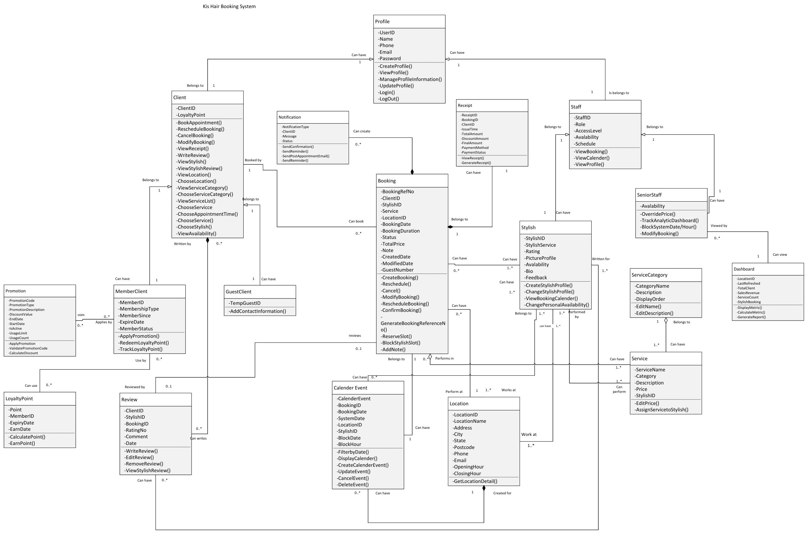
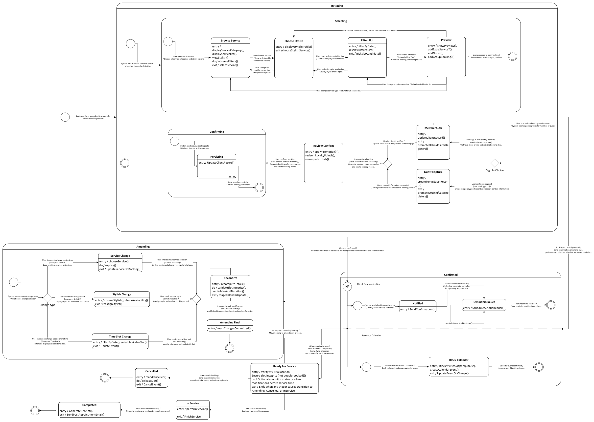
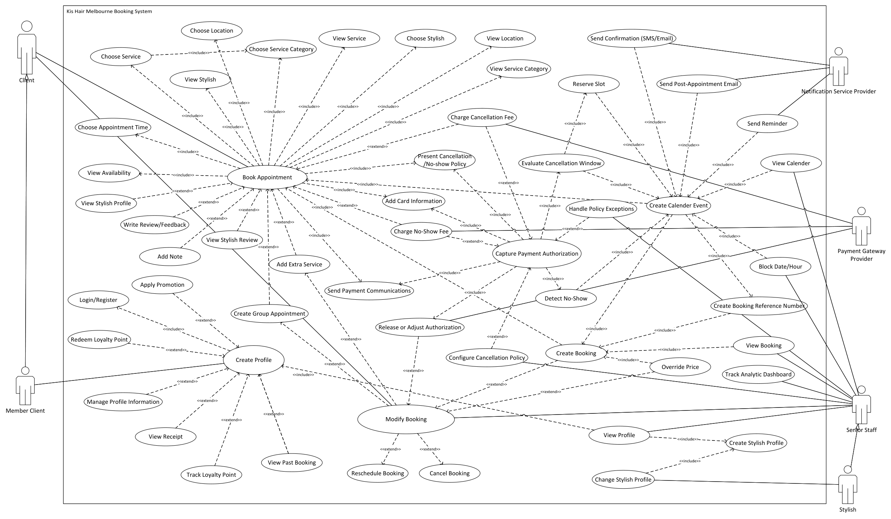

# Software and System Deconstruction using UML Models

A business systems analysis of the booking and scheduling app used by Kis Hair Melbourne, a multi-outlet CBD hair salon running on the MaBa platform. The report reverse-engineers how the system works with four UML models, finds a gap that costs the salon revenue, and redesigns the system to close it.

**[Read the full report (PDF, 46 pages)](./uml-booking-system-report.pdf)**

---

## The business problem

- **Context:** Australian hair and beauty services is an AUD 7.5 billion industry with more than 33,500 businesses (IBISWorld 2025). Kis Hair has 3 outlets in the Melbourne CBD and moved bookings to a mobile app.
- **What the app does well:** 24/7 self-service booking, stylist profiles with reviews, real-time slot availability, group bookings, and automated confirmations and reminders.
- **The gap:** the app cannot take a card on file or charge for late cancellations and no-shows. Salons without such protection see no-show rates of 10 to 30%, which is about AUD 67,000 in lost revenue a year for an average salon (SalonBiz Software 2024). Competing platforms such as Fresha, Treatwell, Booksy, Timely and Square already offer it as standard.

## The UML models

### Activity diagram: how a client books

Four swimlanes (Client, Booking UI, Kis Hair System, Notification Service Provider) trace a booking from the first screen to confirmation, including the loops when a client changes the time, stylist or service.

### Use case diagram: who does what

The functions available to five actors (client, member client, senior staff, stylist and the notification service provider), from booking and modifying appointments to profiles, loyalty points and calendar management.

### Class diagram: the data behind the app

Clients, bookings, stylists, services, locations, calendar events, reviews, loyalty points and promotions, with their attributes, operations and cardinalities. For example, one client makes many bookings.

### State machine diagram: the life of a booking

Every state a booking passes through, from selecting a service and stylist, to confirming, amending, cancelling, being served and completed.

The report also includes an expanded use case for "Book Appointment" with its full step-by-step flow.

## The proposed improvement

**Payment authorisation capture**, built into the booking flow. The client enters card details as the last step before a booking is confirmed. The salon can then set a cancellation policy, process late cancellations and charge no-show fees automatically. The report adds this to two UML models: an updated overall use case diagram (below), with the payment gateway as a new actor, and a new expanded use case for "Capture Payment Authorization".

## Skills shown

Business systems analysis · Requirements and gap analysis · UML (activity, use case, class, state machine) · Business case writing · Competitor benchmarking

## Tools

`UML` · `Microsoft Visio`
